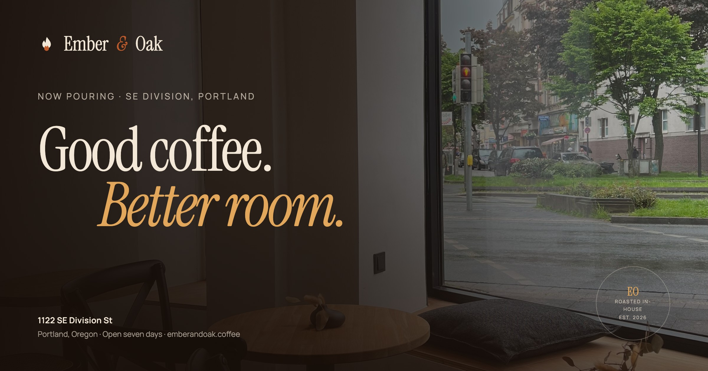

# Ember & Oak — Coffee Shop Landing Page

A warm, editorial one-page site for **Ember & Oak Coffee Roasters**, a fictional specialty coffee house on SE Division in Portland. Built from the product requirements in [`PRD.md`](./PRD.md).

The page is designed around one job: turn a curious visitor into a first-time walk-in. Everything else — the room, the coffee, the people — is proof that it's worth the trip.



## Quick start

```bash
npm install
cp .env.example .env.local   # add your CARTO Basemaps key
npm run dev
```

Open [http://localhost:3000](http://localhost:3000).

Requires Node 20.9+ (developed on Node 22).

### Environment

| Variable | Required | Purpose |
| --- | --- | --- |
| `NEXT_PUBLIC_CARTO_KEY` | Recommended | CARTO Basemaps key for the warm, custom-styled map. Public by design; restrict it by domain in the CARTO dashboard. |
| `NEXT_PUBLIC_SITE_URL` | Production | Canonical origin used for metadata, sitemap, robots and JSON-LD (e.g. `https://ember-and-oak.vercel.app`). Defaults to the fictional brand domain. |

If no key is provided, the map automatically falls back to Esri's Light Gray Canvas so the page still works. Add both `localhost:3000` (and your production domain) to the key's allowed referrers.

## Stack

- **Next.js 16** (App Router, static prerender) + **React 19**
- **TypeScript**, **Tailwind CSS v4** with design tokens in `src/app/globals.css`
- **Leaflet** + **CARTO Positron** raster tiles, CSS-graded to the brand's cream/ember palette
- **next/font** self-hosted: Instrument Serif (display), Manrope (UI), Caveat (handwritten accents)
- **lucide-react** icons

## What's included

- **Hero** — full-bleed room photography, live open/closed chip, directions and "See the room" CTAs, rotating in-house seal
- **Marquee** — oversized alternating solid/outline type; pauses on hover and under reduced motion
- **The Room** — asymmetric editorial collage, sticky manifesto, human stats, coffee-ring ornaments
- **The Coffee** — dark contrast section, house espresso feature, three coffee cards, expandable "On the bar this week" menu
- **The People** — staggered barista portraits and an editorial regular's quote
- **Visit** — the core section: custom-styled interactive map, branded pin and label, popup with directions, lazy-loaded; address, live store-local hours, transit, parking, accessibility, copy/share, phone/email/Instagram
- **The List** — email + optional SMS signup with validation, honeypot, consent copy and a warm success state
- **Footer + sticky mobile action bar** — persistent directions on mobile, hidden near the footer and inert when off-screen

### Details worth noticing

- Store hours are computed in **America/Los_Angeles**, not the visitor's timezone, and update every minute.
- iOS visitors get Apple Maps; everyone else gets Google Maps. Directions are deep links with the full address.
- The map only initializes when it's within 600px of the viewport, keeping the initial bundle light.
- Every photo below the fold is lazy-loaded via `next/image`; the hero is prioritized.
- The mobile menu traps focus, locks scroll, closes on Escape and restores focus.
- `prefers-reduced-motion` disables the parallax-free entrance, seal rotation, marker pulse and marquee motion.
- The form is a **front-end demo**: it validates and shows success but does not persist anything yet.

## Editing content

Most copy and data live in [`src/lib/site.ts`](./src/lib/site.ts):

- Address, coordinates, phone, email, Instagram
- Opening hours (`hours`, Sunday-first, minutes after midnight) and timezone
- Coffee cards and the weekly menu
- Team names, roles and notes
- Navigation and marquee items

Section markup lives in `src/components/`. Design tokens are defined once in `src/app/globals.css` under `@theme`.

## SEO & metadata

- Full metadata, Open Graph and Twitter cards (`src/app/layout.tsx`)
- A custom 1200×630 OG image at `public/images/og.jpg`
- `CafeOrCoffeeShop` JSON-LD with address, geo, hours and sameAs (`src/app/page.tsx`)
- `sitemap.xml`, `robots.txt`, and an SVG favicon
- A minimal `/privacy` page linked from the form and footer

Set `NEXT_PUBLIC_SITE_URL` on the deployment and update the contact/brand details in `site.ts` before launch.

## Accessibility

- WCAG 2.2 AA target; **axe-core scan of the landing page returned 0 violations** at 1440px and 390px (WCAG 2.0/2.1/2.2 A & AA rules)
- Skip link, visible focus states, semantic landmarks, labelled form fields, `aria-live` status/error messages
- Keyboard-operable map with focusable marker and zoom controls; scroll-zoom is opt-in so the map never traps the page scroll
- Text contrast tuned to AA (the ember buttons use a deeper shade to keep cream text legible)
- No information conveyed by colour alone

## Performance

Static prerender, no client-side data fetching, no third-party ad scripts.

Measured against a production build on a simulated mid-tier mobile profile (4× CPU throttle, 1.6 Mbps / 150 ms RTT):

- **LCP ≈ 2.1s**, FCP ≈ 1.3s
- **CLS 0**
- **~578 KB transferred** on first load (17 requests)
- Map JavaScript and tiles load only when the Visit section approaches the viewport

## Project structure

```
src/
  app/
    layout.tsx          fonts, metadata, viewport
    page.tsx            section composition + JSON-LD
    globals.css         design tokens, motion, map skin
    privacy/page.tsx    minimal privacy page
    icon.svg            favicon
    sitemap.ts
    robots.ts
  components/
    Header, Hero, Marquee, Room, Coffee, People, Visit
    Signup, Footer, StickyBar
    MapPanel (lazy gate) · StoreMap (Leaflet) · MapSkeleton
    DirectionsLink, OpenStatus, HoursTable, CopyAddress, ShareButton
    MenuAccordion, SignupForm, RevealInit, ScrollDepth
    Logo, Ornaments, SectionLabel
  lib/
    site.ts             content + hours + directions helpers
    analytics.ts        dataLayer / Plausible event helper
public/images/          photography + OG image
```

## Analytics

`src/lib/analytics.ts` pushes events to `window.dataLayer` and Plausible when either is present, and logs in development. Implemented events:

`cta_directions_click` · `map_loaded` · `map_marker_click` · `map_interact` · `copy_address` · `share_location` · `menu_expand` · `signup_submit` · `scroll_depth`

No provider keys or consent banner are wired up yet. Add the chosen provider and jurisdiction-appropriate consent before launch.

## Before launch

- [ ] Replace the fictional address, phone, email, Instagram and brand claims with the real shop's details; verify coordinates and directions.
- [ ] Domain-restrict the CARTO key (and consider a paid/vector plan if traffic exceeds the free tier). Confirm current CARTO basemap terms for commercial use.
- [ ] Wire the signup form to the CRM/server action, add double opt-in and have SMS consent copy reviewed for TCPA compliance.
- [ ] Replace stock photography with the real shoot and update alt text.
- [ ] Replace the privacy page with counsel-reviewed copy and confirm analytics/consent requirements.
- [ ] Set `NEXT_PUBLIC_SITE_URL` to the production domain and add it to the CARTO key's allowed referrers.
- [ ] Add a real analytics provider and conversion dashboards; validate JSON-LD in the Rich Results Test.
- [ ] Run Lighthouse on the deployed URL; consider adding a CMS (Sanity) so hours/menu can change without a deploy.

## Photography credits

Used as placeholders under the [Pexels](https://www.pexels.com/license/) and [Unsplash](https://unsplash.com/license) licences. The brand, address, people and quotes are fictional.

| Use | Source |
| --- | --- |
| Hero room | [Pexels 16778075](https://www.pexels.com/photo/16778075/) |
| The Room — counter | [Unsplash photo-1453614512568-c4024d13c247](https://images.unsplash.com/photo-1453614512568-c4024d13c247) |
| The Room — window | [Unsplash photo-1445116572660-236099ec97a0](https://images.unsplash.com/photo-1445116572660-236099ec97a0) |
| The Room — evening | [Pexels 14947444](https://www.pexels.com/photo/14947444/) |
| The Coffee — pour-over | [Pexels 10887225](https://www.pexels.com/photo/10887225/) |
| The Coffee — espresso | [Pexels 17987088](https://www.pexels.com/photo/17987088/) |
| Nadia | [Pexels 18189260](https://www.pexels.com/photo/18189260/) |
| Marcus | [Pexels 16537980](https://www.pexels.com/photo/16537980/) |
| Jules | [Pexels 13735876](https://www.pexels.com/photo/13735876/) |

Map data © OpenStreetMap contributors, © CARTO (or Esri when the fallback is active).

## Known limitations

- Signup is visual only; no email/SMS is sent or stored.
- Content is code-managed; no CMS in v1.
- One location only. The map is set up to extend if that changes.
- Hero uses still photography rather than video, deliberately, for mobile performance.
- Address, hours and team are sample content for the demo.
